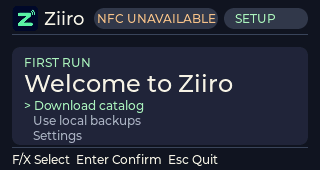
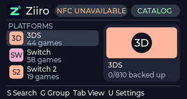
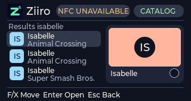
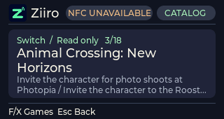
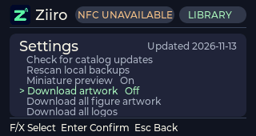

# Ziiro

Ziiro is an amiibo catalog and backup library for the M5Stack Cardputer Zero. Browse figures by series, game franchise, or console, see recorded game effects, and find backups you already have. Optional NFC presentation uses the U219 Cap.

## Changelog

### 1.1.1

- Favourites now uses the same miniature previews, icons, and game subtitles as the other amiibo lists. The list stays flat and alphabetical.

### 1.1.0

- Added Favourites. Press **V** to mark or unmark an amiibo and **G** to cycle to the alphabetical list. **Tab** switches between Library and Catalog within Favourites.
- Added hearts for favourite amiibos and checkmarks for local backups in full-width rows. Favourites are saved by model ID and survive rescans and restarts.
- Figure rows show the title of a single game with a recorded unlock or a count for several games. The platform and game view shows the selected game’s effect.

### 1.0.0

- First Store release with an offline amiibo catalog, a local backup library, and optional NFC presentation.

## How to use Ziiro

The screenshots show the desktop preview at the Zero’s native 320 × 170 resolution.

### Set up your library

1. See [device setup](DEVICE.md) for installation, then open **Ziiro** from HOME.
2. Choose **Download catalog** to fetch amiibo metadata over Wi-Fi, or **Use local backups** to start offline.
3. Put your own raw 540-byte NTAG215 `.bin` backups in `~/ziiro/amiibo_data/` on the Zero. Subfolders are supported. Press **T** to rescan.



### Browse and search

**Library** shows models matched to a local backup, plus unrecognized backups. **Catalog** shows all downloaded entries, including figures you do not have. The downloaded catalog works offline. A match identifies the figure model; it does not establish that a console will accept the backup.

| Browse by console with **G** | Find a figure with **S** |
| --- | --- |
|  |  |

Open a figure and press **I** to see its recorded game effects. Use **F/X** to browse the entries.

Favourites is a flat alphabetical list with the same miniature setting, icons, and game subtitles as other figure lists. In Library it shows favourited amiibos with local backups. In Catalog it shows all available favourites. Search within Favourites covers the current scope.



| Key | Action |
| --- | --- |
| **F/X** or **Up/Down** | Move through lists and settings |
| **Enter**, **Esc** | Open or confirm, go back or leave the app |
| **Tab** | Switch between Library and Catalog |
| **G** | Cycle through series, game franchises, consoles, and favourites |
| **V** | Mark or unmark an amiibo in a list, confirmed search results, or figure details |
| **S** | Type a search and press **Enter** to confirm. Select a result and press **Enter** to open it. |
| **I** | Show recorded compatible games and effects for a figure |
| **T**, **U** | Rescan backups, open Settings |
| **R** | Retry NFC detection on the device |

### Artwork and downloads

**Miniature preview** shows thumbnails in the browser. **Download artwork** is off by default. Enable it to fetch missing previews as you browse, or use **Download all figure artwork** or **Download all logos** in Settings. Press **Esc** to cancel a bulk download. Completed images are kept, so the next run can continue. Console logos are optional downloads and remain available offline once cached. Missing artwork uses colored initials.



Local artwork takes priority. Put a PNG beside a backup with the same basename, or use a custom artwork directory with paths such as `figures/0000000000340102.png`, `series/animal-crossing.png`, `games/super-mario.png`, or `titles/switch/animal-crossing-new-horizons.png`. Use PNGs up to 256 × 256 pixels. See [the device guide](DEVICE.md#user-files-and-upgrades) for profile paths.

### NFC presentation

With a supported U219 CC1101 + NFC Cap attached and **NFC ready** visible, open a figure with a saved backup, press **Enter**, and bring the Cap near the console reader. Press **Esc** to stop the session. NFC is optional for catalog and backup browsing. The app presents existing backups. See [NFC setup and troubleshooting](DEVICE.md#nfc-setup-and-troubleshooting).

If Ziiro shows **NFC SPI missing** after a cold boot, check for `/dev/spidev0.2`. If it is absent, see [the boot overlay workaround](DEVICE.md#nfc-spi-missing) for adding `dtoverlay=spi0-spidev2-gpio22-overlay` and rebooting.

## Build or run on a computer

Install CMake 3.20+, a C/C++ compiler, Git, pkg-config, the SDL2 development files, and Python 3.9+ for downloads. On macOS, install the build dependencies with `brew install cmake pkg-config sdl2 python`. From the repository root:

```sh
cmake -S . -B build
cmake --build build --parallel
./build/ziiro-preview --profile "$(mktemp -d)"
```

The first configure fetches pinned LVGL 9.5.0 and libwebp 1.6.0 sources. Use `--library /path/to/backups` or `--artwork /path/to/artwork` to open your own files. Without `--profile`, the preview uses `build/profile/`. For the ARM64 device build, see [build a Debian package](DEVICE.md#build-a-debian-package).

## Credits

Ziiro is maintained by Marcin Szydłowski. See [third-party notices](THIRD_PARTY_NOTICES.md) for AmiiboAPI, the vendored NFC backend, LVGL, libwebp, SDL2, and artwork sources.
